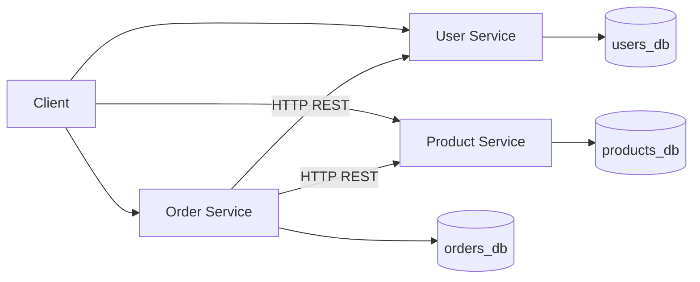

# Go Microservices Order App

A small order management backend built with Go using a microservices architecture.

## Overview

This portfolio project demonstrates three independently deployable REST services, each owning its own PostgreSQL database. Clients can manage users and products, then place orders through the Order Service.

## Architecture



## Services

| Service | Port | Responsibility |
|---------|------|----------------|
| User Service | 8081 | User management |
| Product Service | 8082 | Product and stock management |
| Order Service | 8083 | Order creation and cancellation |

## Tech Stack

Go, REST over HTTP, PostgreSQL, Docker, and Docker Compose.

## API Endpoints

| Method | Path | Service | Purpose |
|--------|------|---------|---------|
| GET | `/health` | all | Health check |
| POST, GET | `/users` | User | Create/list users |
| GET, DELETE | `/users/{id}` | User | Get/delete user |
| POST, GET | `/products` | Product | Create/list products |
| GET, DELETE | `/products/{id}` | Product | Get/delete product |
| PATCH | `/products/{id}/stock` | Product | Set stock |
| POST | `/products/{id}/reserve` | Product | Atomically reserve stock |
| POST, GET | `/orders` | Order | Create/list orders |
| GET, DELETE | `/orders/{id}` | Order | Get/cancel order |

## Getting Started

Requirements: Go 1.22+, Docker, and Docker Compose.

```sh
git clone https://github.com/YOUR_USERNAME/go-microservices-order-app.git
cd go-microservices-order-app
docker compose up --build
```

The APIs are available at `http://localhost:8081`, `http://localhost:8082`, and `http://localhost:8083`. PostgreSQL ports stay internal to the Compose network. To run services directly on your host, start PostgreSQL instances on ports 5433, 5434, and 5435 and run `go run ./cmd/user-service`, `go run ./cmd/product-service`, or `go run ./cmd/order-service`. Configure `DATABASE_URL`, `PORT`, `USER_SERVICE_URL`, and `PRODUCT_SERVICE_URL` through environment variables as needed.

## Example Usage

In a second terminal while Compose is running:

```sh
curl -X POST http://localhost:8081/users -H 'Content-Type: application/json' -d '{"name":"John Doe","email":"john@example.com"}'
curl -X POST http://localhost:8082/products -H 'Content-Type: application/json' -d '{"name":"Mechanical Keyboard","price":79.99,"stock":10}'
curl -X POST http://localhost:8083/orders -H 'Content-Type: application/json' -d '{"user_id":1,"product_id":1,"quantity":2}'
curl http://localhost:8083/orders
curl http://localhost:8082/products/1
```

## Running Tests

```sh
go test ./...
```

## Project Structure

```text
cmd/{user-service,product-service,order-service}/  service entry points
internal/{client,config,database,httpx,order,product,server,user}/ shared and domain code
migrations/{user,product,order}/                     service-owned schemas
Dockerfile, docker-compose.yml, Makefile, README.md
```

## Microservice Principles Demonstrated

- Each service owns its data and schema; there are no cross-database queries or joins.
- Order Service communicates with User and Product services over HTTP.
- Dependency errors are mapped to useful HTTP responses, and service URLs are configurable.
- PostgreSQL connections, request bodies, and HTTP calls have bounded settings.

## Design Decisions

- Each service has a separate database so ownership is clear and services do not couple through shared tables.
- The Order Service uses HTTP to validate users/products and request stock reservation.
- Prices are stored as integer cents to avoid floating point arithmetic in persistence and order totals; APIs expose decimal prices.
- Product Service reserves stock in one conditional SQL update, so concurrent reservations cannot oversell.
- Communication is synchronous REST to keep this educational project easy to follow.
- `DELETE /orders/{id}` sets status to `cancelled`; it does not refund stock.

## Known Limitations

There is no distributed transaction. If stock is reserved and Order Service fails before persisting the order, compensation may be needed. Production systems may address this with a Saga, transactional outbox, or event-driven architecture; none is implemented here.

## Future Improvements

Authentication, an API Gateway, multi-product orders, Saga coordination, event-driven communication, Redis caching, observability, and Kubernetes deployment.

## What I Learned

Designing service boundaries, REST communication, PostgreSQL persistence, Docker Compose, concurrency-safe stock updates, HTTP failure handling, Go testing, and graceful shutdown.
